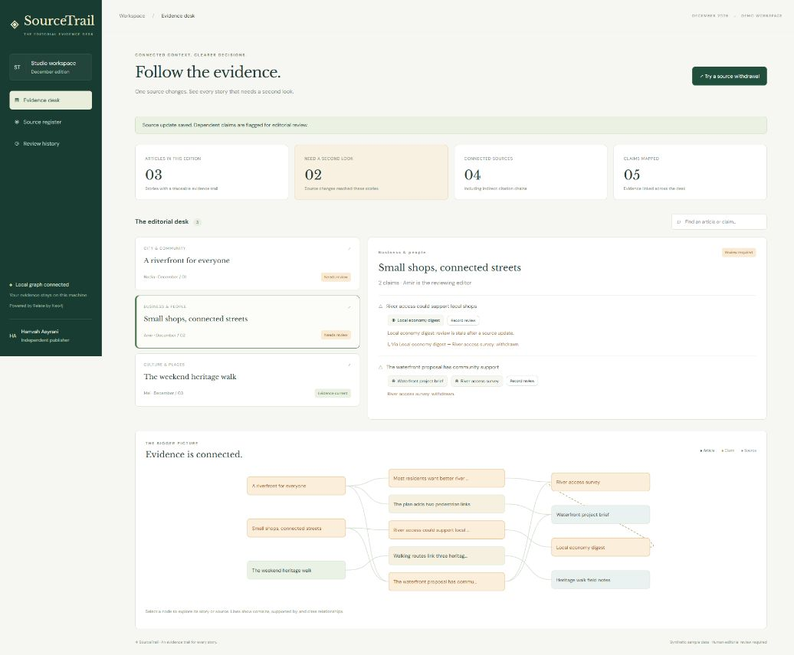

# SourceTrail

**One source changes. Find every story that needs a second look.**

SourceTrail is a local editorial evidence desk for independent publishers. It connects articles to claims, claims to evidence, and sources to the sources they cite. When a source changes or is withdrawn, Relate follows those relationships to identify affected stories, including indirect dependencies that a flat checklist misses.



## Try it locally

Prerequisites: Node.js **22 or later**, npm, and Windows x64, macOS x64/arm64, or Linux x64/arm64 supported by the Relate native package. Development verified on Windows x64 with Node 24.15.0.

```sh
npm ci
npm start
```

Open **http://127.0.0.1:4317**. No account, API key, database server, cloud subscription, or paid model is required. The initial synthetic workspace is seeded automatically, once. npm needs Internet access for installation; the app runs locally afterward. Optional Google Fonts fall back to system fonts when offline.

```sh
npm test
npm run seed
npm run inspect
```

`npm run seed` opens the persistent graph, seeds it only if empty, and prints an inspectable JSON view. It does not reset existing changes. `npm run inspect` opens the included pristine Relate store at `fixtures/editorial/` read-only and prints its nodes and relationships. To start a separate clean workspace, set `SOURCETRAIL_STORE` to a new path before running the server (PowerShell: `$env:SOURCETRAIL_STORE='./data/another-edition'`). Only one server process should write a store. `PORT` defaults to 4317.

## A two-minute demo

1. Open the evidence desk: three articles, five claims, four sources; no open alerts.
2. Select **Try a source withdrawal**. Review the proposed status and reason, then **Save source update**.
3. Two articles now need review. **The weekend heritage walk** is unaffected.
4. Select **Small shops, connected streets**. Its economy claim cites **Local economy digest**, which in turn cites the withdrawn **River access survey**. The UI shows this indirect dependency.
5. Try **Record review** while the upstream survey is withdrawn. The server refuses to clear the evidence.
6. Open the river survey, set it to **Current**, and record why a corrected version is available. Availability is restored, but old reviews remain stale.
7. Record review on the affected evidence links after checking them. A claim shared between articles needs one evidence review, which updates both articles.
8. Open **Review history**. Stop/restart the server or reload the page: updates and history remain.

These are synthetic editorial examples, not factual claims about a real waterfront project. A flag means "review the evidence," not "this claim is false." SourceTrail does not verify truth, scrape sources, infer citations, or grant legal clearance. The editor records the source's status and performs the review.

## How it uses Relate — and why

- **Engine:** `@relate/relate` 1.0.1, running embedded inside Node.js via the official native package.
- **Mode:** persistent **directory store**, at `data/editorial/` by default. This keeps the graph and write-ahead log on the publisher's machine. `db.checkpoint()` also writes a snapshot after mutations.
- **Model:** `Article -[:CONTAINS]-> Claim -[:SUPPORTED_BY]-> Source -[:CITES]-> Source`. Evidence relationships record the reviewed source revision and a stale-review flag. Source updates and human reviews create `Event` nodes.
- **Queries:** parameterized Cypher; `CITES*0..8` traverses direct and indirect dependencies in Relate. Both impact calculation and invalidation of downstream evidence run against the graph, rather than a hardcoded list of affected articles.
- **Writes:** each source update, evidence invalidation and event write is committed in a single transaction. Restoring source availability does not erase stale evidence. Recording a review is blocked while any reachable upstream source remains flagged.
- **Persistence:** normal mutations are durable; tests also reopen the same store in a fresh process. The repository includes a pristine, inspectable Relate directory store in `fixtures/editorial/`. Mutable working stores under `data/` are excluded from Git. The demo shows the live store through the app and `npm run seed`.

The core impact query lives in [graph.js](graph.js). The same source can support several claims and the same claim can appear in several articles, so the graph models shared evidence without duplicating it.

## API

| Route | Purpose |
| --- | --- |
| `GET /api/graph` | Articles, claims, sources, relationships, impacts and event history |
| `POST /api/source` | `{ "id": "s1", "status": "withdrawn", "note": "Sampling error" }` |
| `POST /api/review` | `{ "claim": "c3", "source": "s3" }` |

The server binds to loopback and checks the origin of browser writes. This is a single-user local prototype with no login, roles or multi-user attribution. Do not expose it as a public server.

## Verification

`npm test` runs integration tests against the actual Relate engine:

- Withdrawal reaches direct and indirect dependencies while leaving unrelated stories unaffected.
- Review cannot clear evidence while an upstream source is flagged.
- Restoring a source keeps direct and indirect evidence stale until individually reviewed.
- Graph state and history survive a process restart, with no duplicate seeding.
- Invalid source updates and nonexistent evidence links leave history unchanged.

The browser flow has also been exercised in Chrome on Windows. The graph currently limits citation traversal to eight hops; deeper chains are outside this prototype. The demo workspace supports source editing and evidence review; adding articles, claims and citation links currently requires modifying the seed graph in code and using a fresh store. A production version would add an import/editor and explicit reviewer identities.

## Originality, AI and third-party tools

Created for the Relate by Neo4j Hackathon beginning **15 November 2026**. No code is reused from the author's earlier hackathon projects.

Significant AI assistance: OpenAI Codex helped design the graph model, generate and revise code, create the synthetic sample data, test the implementation, and draft documentation and submission copy. The app itself makes **no AI model calls** and does not automatically decide whether an article is accurate or publishable.

Dependencies: Relate (Apache-2.0), its native platform package, and Koffi (MIT), installed through npm. The lockfile records exact versions. Optional typography: DM Sans and Libre Baskerville from Google Fonts, under the SIL Open Font License; system fallback fonts work offline. No stock imagery or music is used. Relate and Neo4j names identify the integration and do not imply endorsement.

SourceTrail code is MIT licensed. See [LICENSE](LICENSE).

## Demo presentation source

[69-second demo MP4](demo/sourcetrail-demo.mp4) · [Timed English commentary](demo/commentary.vtt)

This is a silent presentation of actual browser screenshots, captured while exercising the app. It contains no simulated UI, generated images, narration or music. `demo/timeline.json` retains the edit decisions, `demo/manifest.json` records provenance and timing, and `demo/render.py` rebuilds the MP4 with Pillow and imageio-ffmpeg. Rendering dependencies are separate from the app. The export was fully decoded for errors and frames from every scene were visually checked; real-time playback was not reviewed.
